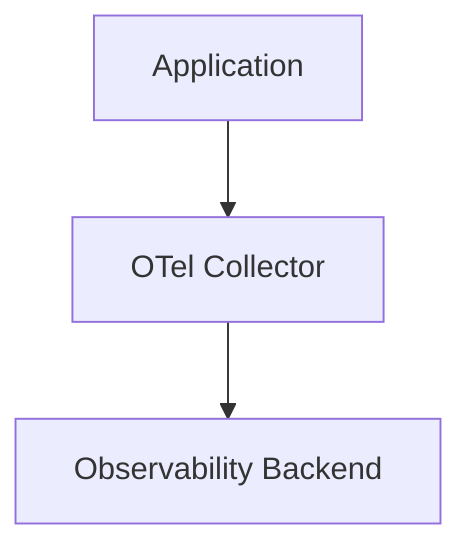

## この記事で扱うこと

OpenTelemetry(以下 OTel)について学んでいくと、OpenTelemetry Collectorの存在を認識すると思います。
この記事では、「OTel Collectorはどのようなシチュエーションで実際に業務で利用するのだろうか？」と考えるものです。
そのため、以下については扱いません。

- OTel Collector自体の詳細[^1]
- OTel Collectorを実際に導入したという実体験について

## OTel Collector概要

OTel Collectorは、アプリケーションとObservability Backendの間に配置するテレメトリデータの中継コンポーネントです。
(Observability BackendはDatadog とか NewRelic等のSaaSもあればセルフマネージのJaeger等あると思います)

OTel Collectorでは、以下のような処理をアプリケーションの外側で行うことができます。

- Tail Sampling
- Batch送信やRetry
- Attributeの追加・削除などの加工
- 複数Backendへのルーティング

アプリケーションから直接Backendへ送信する構成も可能ですが、Collectorを利用するとTelemetryに関する一部の責務をアプリケーションから分離できます。

この記事では、Collectorの詳細ではなく「どのような場合に、この責務分離が有効なのか」を考えます。

## OTel Collectorを導入する理由を考える

### Tailサンプリング

SDKでサンプリングする場合、サンプリングの初期値は Head basedサンプリングになるかと思います。
参考: https://opentelemetry.io/docs/languages/sdk-configuration/general/#otel_traces_sampler

Head basedのサンプリングでは確率的なサンプリングになりますが、Tail basedのサンプリングではエラーを含むトレースは常にサンプリングするなどの設定が可能になります。
参考: https://opentelemetry.io/ja/docs/concepts/sampling/#tail-sampling

OTel標準の仕組みとしてTailサンプリングを実現するならCollectorが必要になります。

#### 問い:そもそもサンプリングしていいのか？

BtoBサービスの場合、監査や契約上の理由でログ等の保存要件が定められている場合があります。
その場合、トレースについても「サンプリングして破棄してよいデータなのか」という判断が必要になります。

#### 問い:Observability SaaSで代替可能か？

各種Observability SaaSにTailサンプリング、または類似の機能があります。

- Datadog
  - 送信前にTailサンプリングする機能は無さそう
  - ただ課金体系としてデータ取り込みとインデックス化で料金が別で、インデックス化について[Retention Filters](https://docs.datadoghq.com/ja/tracing/trace_pipeline/trace_retention/)でのコスト削減が可能ぽい
- Dynatrace
  - 送信前にTailサンプリングする機能は無さそう
  - [OpenPipeline](https://www.dynatrace.com/platform/openpipeline/)のフィルタ機能で保持データ量の削減によるコスト削減が可能ぽい
- NewRelic
  - [Infinite Tracing](https://docs.newrelic.com/jp/docs/distributed-tracing/infinite-tracing/introduction-infinite-tracing/)という名前で[OTel Collectorのtail sampling processorをベースにした仕組みを提供](https://docs.newrelic.com/docs/distributed-tracing/infinite-tracing-on-premise/bring-your-own-cache)している様子[^2]

OTel Collector自体をホストしてメンテナンスや保守する労力と、Observability SaaSの機能を用いてコスト削減をできる範囲で実施したうえでさらにデータ取り込み箇所を削減した場合のコスト削減が見合うのかの検討を慎重にしても良いのかなと思ったりもします。

### テレメトリ送信の集約による通信の安定性や効率の向上

コレクターを利用しない場合、SDK導入箇所が直接トレースデータを送信します。
そのため、各アプリケーションがそれぞれBatchingやRetryなどの送信処理を担うことになります。
OTel Collectorを間に置けば、これらをサービスの外に切り出して集約でき、圧縮効率の向上などの通信効率の改善が期待できます。

#### 問い:サービス実行基盤はどのようなものか？

k8s等でCollectorをアプリケーションと同じネットワーク境界内に配置できる場合は、OTel CollectorがBatch処理してObservability SaaSに送信する構成にすると通信が安定する方向性になると思います。

ただサーバーレス環境やECSのようなコンテナ仮想化サービスにおいてはこのようなメリットは享受しにくいのではと思います。
📝私はK8sを仕事で使っていて他の実行環境の事情には詳しくないので、ぼんやりした書き方になっています。すみません。

### テレメトリの加工

OTel Collectorで受けて一箇所でデータを加工することができます。
📝自分はあまりこのモチベーションを感じたことは無いので軽く調べた限りなのですが、大規模開発で複数チームが開発を進めていて、もう既にテレメトリの差異が出ているけれど、最終的な分析時に困らないように差異を吸収する層として設けるような感覚なのでしょうか？
📝アプリケーション開発者が意識すべきではないObservabilityポリシーとかの例があれば誰か教えてほしいです

#### 問い:アプリケーションへの変更を加えるのは諦めるのか、過渡期の対応なのか？

「テレメトリへの差異を後段の分析のしやすさのために加工する」というモチベーションで導入するのであれば、その差異の吸収をOTel Collectorで吸収するのは恒久対応とするのか一時的な対応とするのか、スタンスを明確にしておいたほうが良いのかなと思っています。
アイデアベースですが、社内向けsemconvを書く等で、OTelを利用するサービスたちに付与する属性の規則を決めたほうが保守コストの観点では良いのかなと思います。

#### 問い:Observability SaaSで代替可能か？

Observability SaaSへの送付後にデータの加工をする機能もあったりするので、それで十分かも検討したいところです。

- Datadog
  - [Processing Pipelines](https://docs.datadoghq.com/tracing/trace_pipeline/processing_pipelines/)
  - 📝たぶんAPM利用じゃなくてOTelでも利用できそうです。業務利用してないので不正確です
- Dynatrace
  - [OpenPipeline](https://www.dynatrace.com/platform/openpipeline/)
- NewRelic
  - [Pipeline Control Gateway](https://docs.newrelic.com/docs/new-relic-control/pipeline-control/gateway/overview/)

### 複数バックエンドへのテレメトリ送信

特定のフラグが付いたテレメトリは社内分析に回すために別の分析基盤に送信する、等のフィルタとテレメトリの複製送信ができます。

#### 問い:内部ルーティングで解決できませんか？

特定のホスト名でサービスを提供しているユーザーのみ内部でルーティングして、別のpodで動かしてしまうという考え方もあるのではと思います。
k8sであればNamespaceを分け、Deploymentを分けることで他のpodとテレメトリの送信先を切り分けるといった具合です。
もちろんあくまでそのユーザーなり分析単位を「かなり特別扱いしている」という場合に取るアプローチではあるという前提で、バックエンド送信先振り分けを実現したいだけならば他にもアプローチはあるのではという考察です。

#### 問い:Observability SaaSで代替可能か？

一度全てObservability SaaSへ送信してしまってから、また別の分析基盤に送り直すアプローチです。
大抵のObservability SaaSではDBやストレージへのエクスポートやストリーミング機能があります。
社内分析用途など、用途によってはCollectorを立てるに及ばないのかなと思います。

## まとめ

自分が社内で「OTel Collectorってのあるらしいけど、これは入れないの？」と言われたときに考えてたことを明文化しておきました。
個人の見解としては、それぞれのよくあるモチベーションについて以下のような回答として、現時点の自分の環境ではOTel Collectorの導入は見送りました。

Q1. Tailサンプリングするか
A1. 顧客との契約上サンプリングしていいのか分からないし今のところコストが契約内なので全送信でいいか～

Q2. テレメトリ送信の集約による通信の安定性や効率の向上
A2. 今のところコネクション数やSaaS側のrate limitあたりも問題になっていないので、重視しなくていいか～

Q3. テレメトリの加工
A3. 現状はopentelemetry-goによる手動計装をしており、テレメトリの設計をアプリケーション側で管理できているため、コレクターでも加工モチベーションが無い

Q4. 複数バックエンドへのテレメトリ送信
A4. このモチベーションだけはあって、内部ルーティングするにもサービスメッシュ導入からになるし、分析に使いたい基盤の選定によってはCollector立てるかもな～と悩んでいるところ

あと、もし以下のようなモチベーションの場合はほぼCollector導入するかなと思っています。

- 監査の関係とかで特定の情報をとにかく外部に送信する前に叩き落したい
- マイクロサービスの稼働環境が過酷な環境で、とにかくマイクロサービス側の責務を小さくしたい

📝自分はこんな理由でOTel Collector導入即決だったよ！って事例があればおしえてください。

[^1]: 念のためOTel Collectorを知らない方向け、かつ私の理解の誤解が無いかを読者の方に判断いただくために概要は記載します

[^2]: New Relic's Infinite Tracing Processor is an implementation of the OpenTelemetry Collector tailsamplingprocessor.
